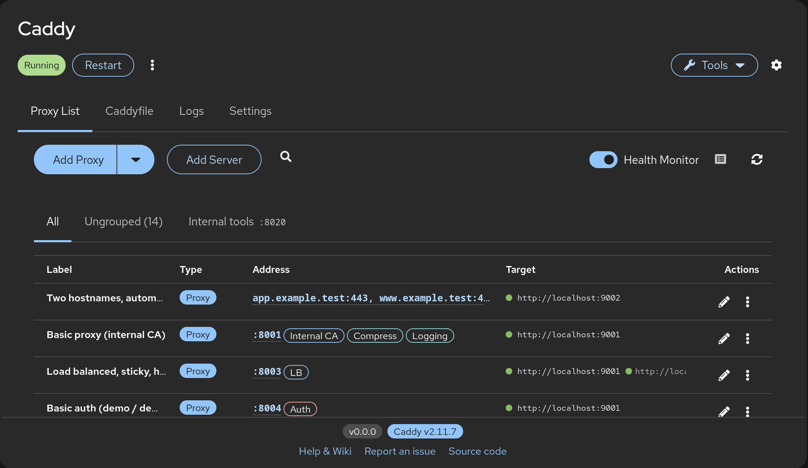

# Cockpit Caddy Plugin

[](https://github.com/RXTX4816/cockpit-caddy/actions/workflows/ci.yml)
[](https://github.com/RXTX4816/cockpit-caddy/actions/workflows/pkg-ci.yml)

[Caddy](https://caddyserver.com) management for [Cockpit](https://cockpit-project.org) — reverse proxies, static sites and HTTPS from a clean web UI, written to a Caddyfile you can still edit by hand.



## Features

| | |
|---|---|
| **Sites** | Reverse proxies, static files (browse, SPA fallback, precompressed), PHP via PHP-FPM, redirects and fixed responses; several hostnames per site |
| **Named servers** | Many routes on one port, picked by path, host, method, header, query or client IP, with exclude groups and CEL expressions |
| **HTTPS** | Automatic Let's Encrypt / ACME certificates for public names, Caddy's internal CA for local ones, or your own files; on-demand TLS; DNS challenge globally or per site, with credentials kept out of the Caddyfile |
| **Upstreams** | Every Caddy load-balancing policy including sticky sessions, retries, passive and active health checks, and a live reachability monitor |
| **Security** | Basic auth, forward auth, TLS policy and client certificates, trusted proxies and the PROXY protocol |
| **Caddyfile** | Highlighted viewer and editor, validation before every save, shared snippets; hand edits are picked up and a distro's stock Caddyfile is taken over on the first save |
| **Inspect** | Log table with filters, certificate status and errors per hostname, the internal CA, a config check, and backup and restore |
| **Anywhere** | Caddy as a systemd service, or running elsewhere (Docker, rootless Docker) through its Admin API |

Each feature is described in the [wiki](https://github.com/RXTX4816/cockpit-caddy/wiki).

## How it works

Every site is a block in `/etc/caddy/conf.d/cockpit-caddy.conf`, which the main Caddyfile imports. Saving a site rewrites only its own block, checks the whole config with `caddy validate`, and applies it. Two common setups:

```
https://192.168.1.100:8443  →  localhost:8080     one port per service, Caddy's internal CA
https://cloud.example.com   →  localhost:8080     a public name, certificate from Let's Encrypt
```

## Requirements

- Cockpit 300+
- Caddy 2 with its Admin API on (the default: `localhost:2019`, or a Unix socket)

Install Caddy from your distribution (`pacman -S caddy`, `apt install caddy`, `dnf install caddy`) and run `sudo systemctl enable --now caddy`. For Caddy in a container, see [Service Control: External mode](docs/wiki/Service-Control.md#external-mode).

## Installation

**Arch Linux**

```bash
paru -S cockpit-caddy
```

**Fedora / RHEL / CentOS Stream / openSUSE**

```bash
curl -LO https://github.com/RXTX4816/cockpit-caddy/releases/latest/download/cockpit-caddy-latest.rpm
sudo rpm -i cockpit-caddy-latest.rpm
```

**Debian / Ubuntu / Linux Mint / Pop!\_OS**

```bash
curl -LO https://github.com/RXTX4816/cockpit-caddy/releases/latest/download/cockpit-caddy-latest.deb
sudo apt install ./cockpit-caddy-latest.deb
```

<details>
<summary><b>Manual install</b></summary>

```bash
curl -LO https://github.com/RXTX4816/cockpit-caddy/releases/latest/download/cockpit-caddy-latest.tar.gz
curl -LO https://github.com/RXTX4816/cockpit-caddy/releases/latest/download/cockpit-caddy-latest.tar.gz.sha256
sha256sum -c cockpit-caddy-latest.tar.gz.sha256
tar -xzf cockpit-caddy-latest.tar.gz
sudo mkdir -p /usr/share/cockpit/cockpit-caddy
sudo cp -r cockpit-caddy/* /usr/share/cockpit/cockpit-caddy/
```

</details>

Then reload Cockpit — **Caddy** appears in the left navigation.

## Translations

The UI follows Cockpit's language setting.

<!-- i18n-coverage-start -->
| Coverage | Languages |
|---|---|
| 100% | English (`en`) — source, `ar`, `cs`, `de`, `es`, `fi`, `fr`, `he`, `id`, `it`, `ja`, `ka`, `ko`, `nl`, `pl`, `pt-BR`, `ro`, `ru`, `sk`, `sv`, `tr`, `uk`, `zh-CN`, `zh-TW` |
<!-- i18n-coverage-end -->

To add a language, copy `src/i18n/locales/en.json`, translate the values, and open a PR.

## Development

```bash
git clone https://github.com/RXTX4816/cockpit-caddy.git
cd cockpit-caddy
npm install
npm run build
```

Requires Node.js 22+. Built on [`@rxtx4816/cockpit-plugin-base-react`](https://github.com/RXTX4816/cockpit-plugin-base-react). See [CONTRIBUTING.md](CONTRIBUTING.md) for live reload, tests and commit conventions, [VM Testing](docs/wiki/VM-Testing.md) for the QEMU test VMs, and [Manual Testing](docs/wiki/Manual-Testing.md) for the release checklist.

Bugs and feature requests go to [GitHub Issues](https://github.com/RXTX4816/cockpit-caddy/issues). Security issues: please report privately — see [SECURITY.md](SECURITY.md).

## Versioning

Releases follow [semantic versioning](https://semver.org): patch releases fix bugs, minor releases add features, and anything that breaks existing setups waits for a new major version. See [Releases](https://github.com/RXTX4816/cockpit-caddy/releases) for what changed in each version.

## License

[AGPL-3.0-only](LICENSE) © 2026 RXTX4816. Earlier releases were MIT — see [LICENSE-HISTORY.md](LICENSE-HISTORY.md). Bundled third-party licenses are listed in [THIRD-PARTY-NOTICES.txt](THIRD-PARTY-NOTICES.txt).
