# Managing Entries

Entries can be added, edited, duplicated, and deleted from the [Proxy Dashboard](Proxy-Dashboard) without touching the Caddyfile directly.

---

## Named Servers

A **named server** is a virtual host that owns a listen port and contains multiple routes. Routes inside a server share the port and use **route matchers** to decide which route handles each request.

Use named servers when you want to serve multiple services on a single port — for example, routing `/api/*` to a backend and everything else to a frontend, all on `:443`.

### Creating a server

Click **Add Server** in the toolbar.

| Field | Description |
|---|---|
| Display Name | Human-readable label for the server tab (e.g. `Public HTTPS`) |
| Listen Ports | One or more ports this server listens on (e.g. `:443`) |
| HTTPS | On (default): HTTPS for the whole server with Caddy's internal CA. A named server only listens on ports, so it can't get an automatic (ACME) certificate. Off: plain HTTP |

The server gets a unique key (slug) derived from its name. Once created it appears as its own tab in the proxy list.

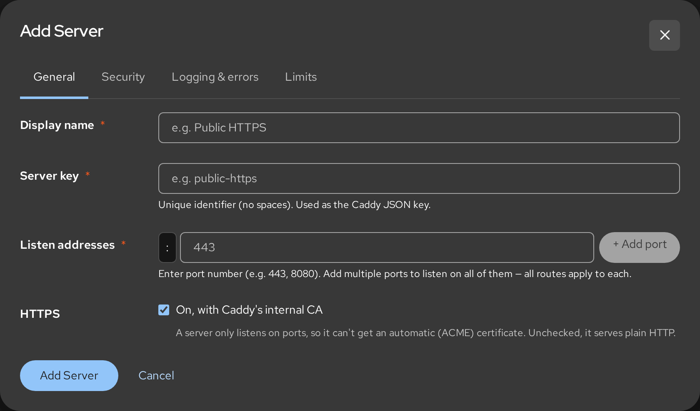

The Add and Edit Server dialogs use the same tabs as a site: General (name, listen addresses, HTTPS), Security, Logging & errors and Limits.

### Adding routes to a server

Open the server's tab and use **Add Proxy** or its arrow (**More site types**). Routes added here belong to the server — they do not have their own port.

### Server detail panel

Each server tab shows:
- A **server info card** with listen addresses (clickable `↗` links), TLS state, and timeouts.
- A **routes table** with one row per route. Each row has a clickable `:<port>[/path]` link that opens the route's external URL directly.

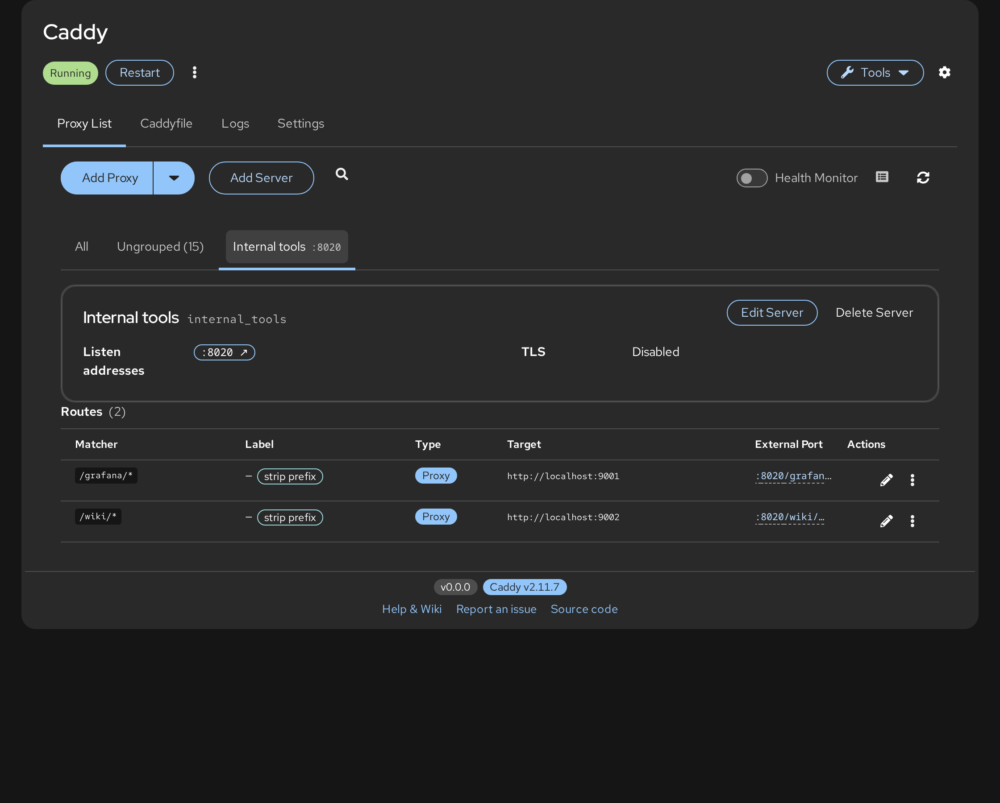

### Editing and deleting a server

Use the **Edit Server** and **Delete Server** buttons in the server info card. Deleting a server removes it and all its routes.

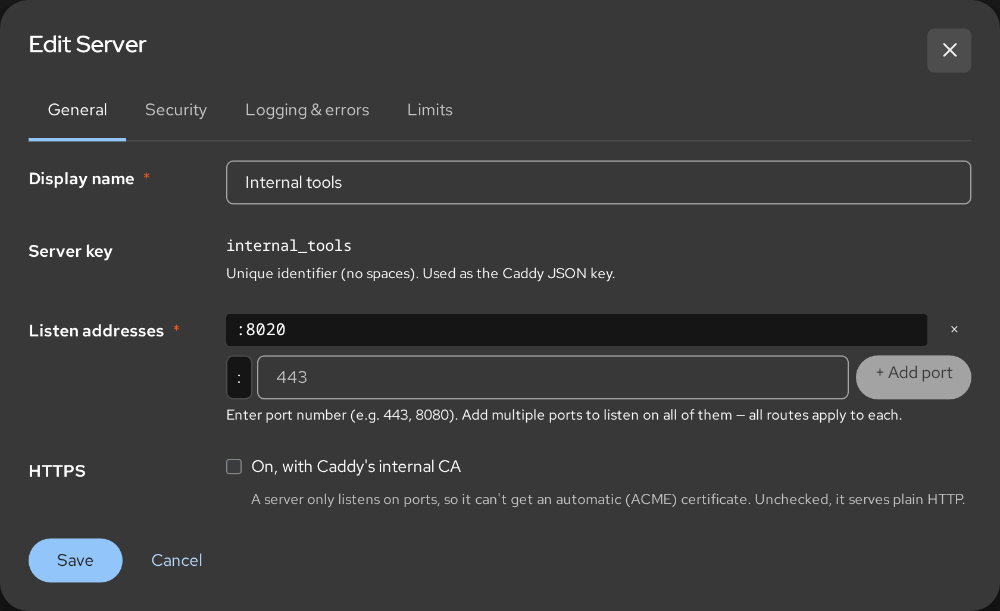

---

## Route Matchers

Route matchers restrict which requests a route handles. They are available in all Add/Edit dialogs, on the **Routing** tab.

When a route has no matchers, it is a **catch-all** — it handles any request that was not matched by an earlier route.

When multiple matchers are set (e.g. path + host), they are combined with AND logic (all must match).

| Matcher type | Example | Notes |
|---|---|---|
| **Path** | `/api/*` | Glob patterns. `*` matches a single segment; `**` or `/*` matches any suffix |
| **Host** | `example.com` | Exact hostname match |
| **Method** | `POST`, `PUT` | One or more HTTP methods |
| **Header** | `X-Auth: Bearer*` | Header name + optional value pattern; leave value blank to match header presence |
| **Query param** | `debug=true` | URL query parameter name + optional value |
| **IP address** | `10.0.0.0/8` | **Client IP** (`client_ip`, the default for new matchers): the visitor's IP, read from the forwarded header when the request comes through a trusted proxy (Settings → Trusted proxies); without trusted proxies it is the connection IP. **Connection IP** (`remote_ip`): the TCP peer, which behind a proxy or CDN is the proxy. Existing `remote_ip` matchers stay `remote_ip` |
| **Exclude** | path `/api/private/*` | "Exclude requests that match": a request matching all of these fields is skipped even when it matches the fields above (Caddy's `not` block) |
| **Path regex** | `^/user/(\d+)$` | `path_regexp`, with an optional name: a named regex makes its groups available as `{re.name.1}`, for example in a rewrite. Caddy allows one regex per matcher |
| **Header regex** | `Authorization ^Bearer .+$` | `header_regexp` on one header, with an optional name like the path regex |
| **Protocol** | `https` | `protocol`: http, https or grpc |
| **Files** | `{path} {path}/index.html` | `file`: matches when one of the files exists; how to pick: first existing (with or without fallback), smallest, largest or most recently modified |
| **Variables** | `{host} example.com www.example.com` | `vars`: one per line, a placeholder followed by the values it may have |
| **Expression (CEL)** | `{method} != 'DELETE'` | A condition that must also be true, with placeholders like `{path}` or `{method}`. Caddy checks it when you save. See Caddy's [expression matcher](https://caddyserver.com/docs/caddyfile/matchers#expression) |

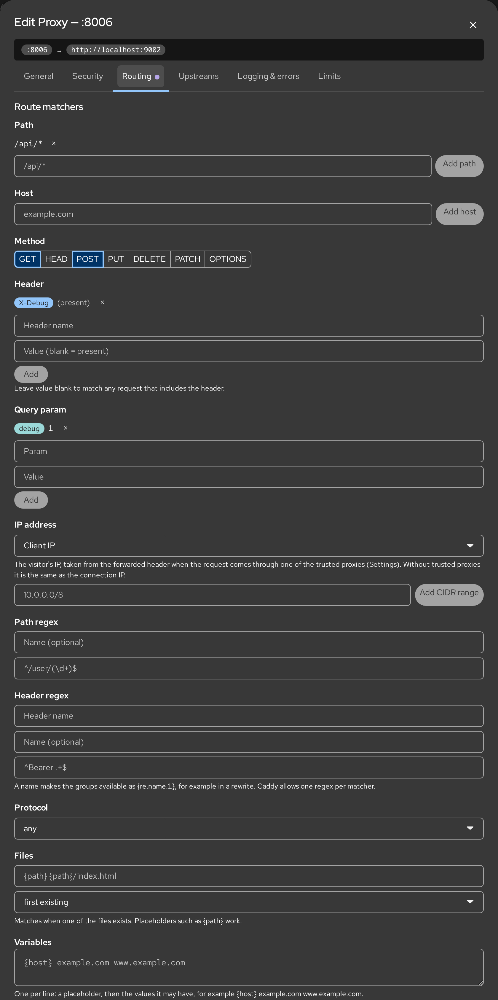

The exclude group has the same fields; the CEL expression sits below it:

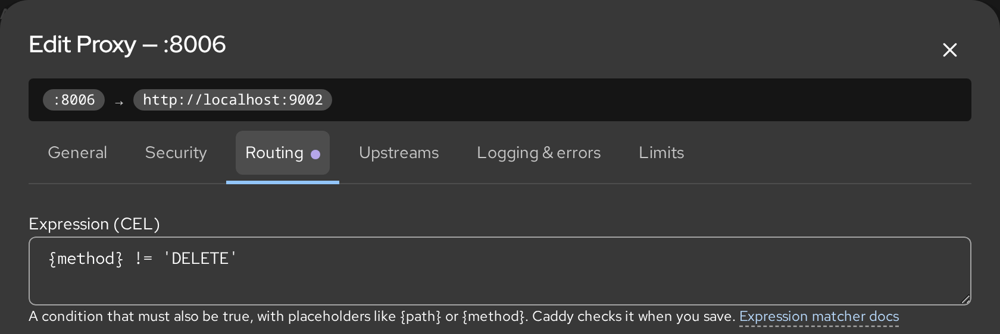

### Strip matched path prefix (handle_path)

When only a **path** matcher is set, a "Strip matched path prefix" checkbox appears. Enabling it uses Caddy's `handle_path` directive:

- The external URL includes the path prefix: `https://host:443/api/orders`
- Caddy strips the prefix before forwarding: the upstream receives `/orders`

Without strip, the upstream receives the full path `/api/orders`.

---

## Reverse Proxy

Click **Add Proxy** in the toolbar.

### Required fields

| Field | Description |
|---|---|
| External Address | Port (and optionally scheme + hostname) Caddy listens on — omitted when adding to a named server. Several hostnames can share one proxy: separate them with commas (`example.com, www.example.com`) and they are written as one site block with every name. The host only matches requests, an IP address too; to open the port on some interfaces only, list them under **Bind addresses** (`bind`) |
| Target Host | Upstream host to forward traffic to (default `localhost`) |
| Target Port | Upstream port |

### Common optional fields

| Field | Description |
|---|---|
| Label | Human-readable name (e.g. `Nextcloud`) |
| HTTPS certificate | **Automatic (Let's Encrypt / ACME)** — the default for a public hostname: Caddy gets and renews a public certificate, no `tls` line is written. **Caddy's internal CA** — the default for a bare port, an IP or a local name (`tls internal`); browsers trust it only where the CA's root is installed. **Off** — plain HTTP. A certificate file under TLS settings overrides the issuer. Inside a named server, TLS is set on the server. The **On-demand** checkbox (while HTTPS is on) gets the certificate at the first TLS handshake instead of up front (`tls { on_demand }`), for names not known in advance; set an ask endpoint under Settings → On-demand TLS first. |
| DNS challenge | Shown under Automatic HTTPS. **Inherit global** (default) uses the provider from Settings → DNS challenge, or the HTTP challenge when none is set. **Override** gives the site its own provider and credentials (`tls { dns <provider> {env.CADDY_DNS_SITE_…} }`); the values go to `/etc/caddy/dns.env` under per-site names, and saving new ones restarts Caddy, since it reads them only at start. A wildcard host without any DNS provider gets a warning. Deleting the site removes its variables. |
| Compression | Enable gzip/zstd response compression |
| Skip TLS verify | Skip verification of the upstream's TLS certificate (for self-signed backends) |

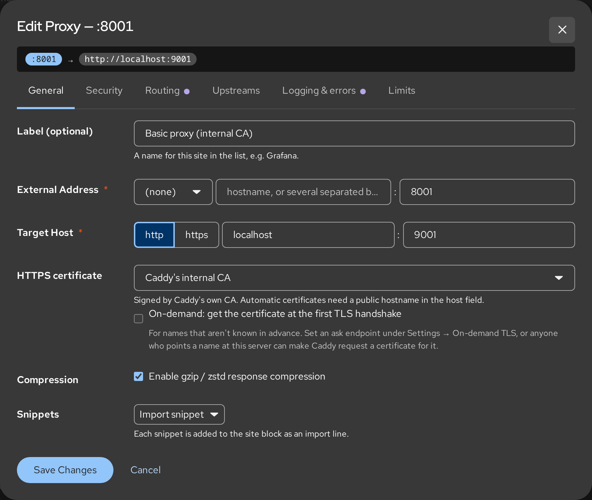

### Tabs

The Add and Edit Proxy dialogs split their settings into six tabs. A tab shows a small dot once something in it differs from the defaults, and an error icon when it holds an invalid value; **Add** / **Save** jumps to the first tab with an error. Inside a tab every section is shown open, there are no Clear / Defaults buttons, and a field that falls back to a Caddy default gets a **Reset to Caddy default** button (↶) once it holds a value. Empty fields show the default greyed out ("Default: 5m") or an example ("e.g. 8080").

Sizes (max request body size, max header size) are entered as a number and a unit (bytes, KB, MB, GB) and stored in bytes.

| Tab | Sections |
|---|---|
| **General** | Label, external address (`[protocol ▾] [host] : [port]`), target (`http` / `https` toggle, host, port), HTTPS certificate, snippet imports |
| **Security** | HTTP Basic Auth, Forward Authentication, TLS Policy |
| **Routing** | Route Matchers, URI Rewrite, Request Headers, Response headers from the upstream, Response Headers, Compression settings, named route (`invoke`) |
| **Upstreams** | Additional Upstreams and load-balancing policy, Dynamic Upstreams, Retry & Failover Tuning (including health checks), Upstream Timeouts, streaming and the upstream connection |
| **Logging & errors** | Access logging, Custom error handlers |
| **Limits** | Server Timeouts & Limits (read/write/idle timeouts, max header size, TCP keep-alive, request body idle timeout, connection options, HTTP/3 opt-out), Bind addresses, Max request body size |
| **Tree** | Only for a site with `route` or nested `handle` blocks, see [Tree tab](#tree-tab-nested-route-and-handle-blocks) |

The static, redirect, respond and PHP dialogs use the same tabs, with fewer of them: static and PHP have General, Security (HTTP Basic Auth, TLS Policy), Routing (Route Matchers, Request Headers, Response Headers), Logging & errors and Limits; redirect and respond have General and Routing (Route Matchers). The PHP environment variables sit on General, next to the optional **Try files** field (`try_files`, e.g. `{path} {path}/ /index.php?{query}` for a front-controller app).

| Section | What it configures |
|---|---|
| **TLS Policy** | Protocol versions, cipher suites, curves, mTLS, internal-issuer certificate lifetime — or a custom/bring-your-own certificate (point at existing cert + key PEM files instead of Caddy issuing one). For automatic HTTPS also the site's own ACME email, ACME CA directory URL and key type (empty uses the global ones) |
| **Access Log** | Per-site access logging: output, format, level, rotation, **field filters** (`delete`, `hash`, `replace`, `ip_mask` on a field such as `request>headers>Authorization`), loggers to take in or leave out, and **paths to leave out of the log** (`log_skip`, e.g. `/health*`) |
| **Error Handlers** | Custom responses for 4xx/5xx errors |
| **Forward Auth** | Delegate authentication to an external service: auth URL and URI, headers to copy to the upstream (`Name>Other` copies under another name), request headers sent to the auth service, and trusted proxies whose `X-Forwarded-*` headers are kept |
| **Upstream Timeouts** | Connect timeout, response header timeout, and for streaming (websockets, event streams) flush interval, stream timeout and stream close delay |
| **Upstream connection** | TLS server name, HTTP versions (e.g. `h2c 2`), read and write timeouts, keep-alive and the idle connection pool |
| **Dynamic Upstreams** | Look the upstreams up in DNS (`SRV` or `A`/`AAAA`), with refresh interval, resolvers and address families; the target is the fallback when a lookup finds nothing |
| **Server Timeouts** | Read body, read header, write and idle timeouts, max header size, TCP keep-alive interval and idle time, request body idle timeout (`read_body_idle`), strict SNI host, log credentials, full duplex for HTTP/1, and HTTP/3 opt-out |
| **Bind addresses** | The addresses the site listens on (`bind`); empty listens on every address |
| **Basic Auth** | Username/password protection, with realm and hash algorithm (bcrypt or argon2id) |
| **Rewrite** | Strip prefix or suffix, add prefix, regex, replace text in the path, query string changes (set, add, delete, rename, replace), or change the method |
| **Request Headers** | Add, set, or delete upstream request headers |
| **Response headers from the upstream** | `header_down`: set, add, delete or replace headers in the upstream's response |
| **Response Headers** | Add, set, or delete downstream response headers, with security presets (HSTS, nosniff, frame options, referrer policy, remove `Server`). **Default** (`header ?Name value`) sets a header only when the response has none; **Replace** (`header >Name find replacement`) changes part of a value, as plain text or, with **Regular expression**, a regexp where `$1` inserts a group |
| **Compression** | While compression is on: algorithms and their order, minimum size, and only some status codes or response headers |
| **Extra Upstreams** | Additional upstream targets with a load-balancing policy: random (Caddy's default), round robin, least connections, first available, weighted round robin (one weight per upstream, the main target included), best of random n, connection IP hash, client IP hash, request path hash, request header, or cookie (sticky sessions, optional cookie name and secret) |
| **Retry & Failover Tuning** | Max retries and retry duration/interval — applies even with a single upstream. **Passive health checks**: a fail duration, max fails, and the upstream status codes that count as a failure; an upstream that fails too often is taken out of rotation for the fail duration (Caddy only runs passive checks with a fail duration). **Active health checks**: a path Caddy requests on every upstream, with interval, timeout and expected status (`200` or a class like `2xx`) |
| **Route Matchers** | Path, host, method, header, query, client / connection IP, path and header regex, protocol, files, variables, an exclude group and a CEL expression |

**Security tab** (Basic Auth with realm and hash algorithm, Forward Auth, TLS Policy):

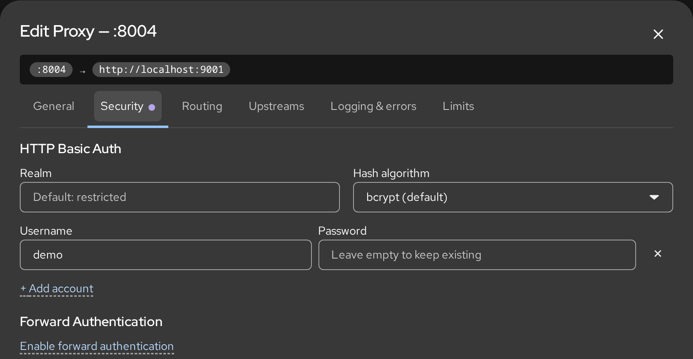
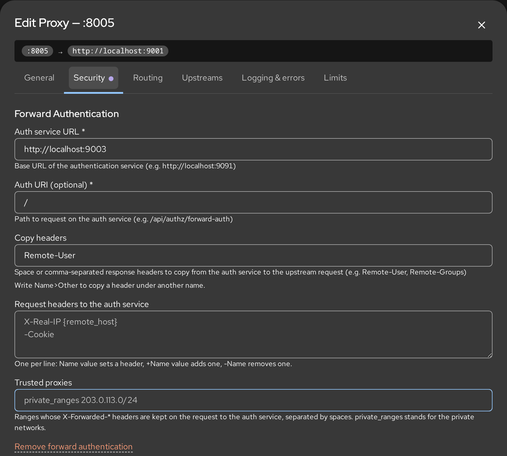
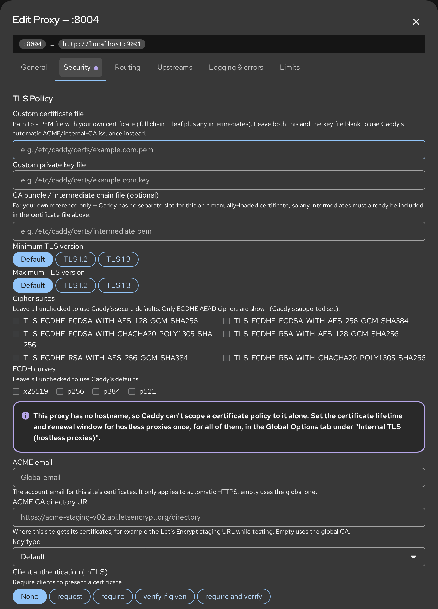

**Routing tab** (below the matchers): rewrite, request headers, headers from the upstream, response headers, then compression:

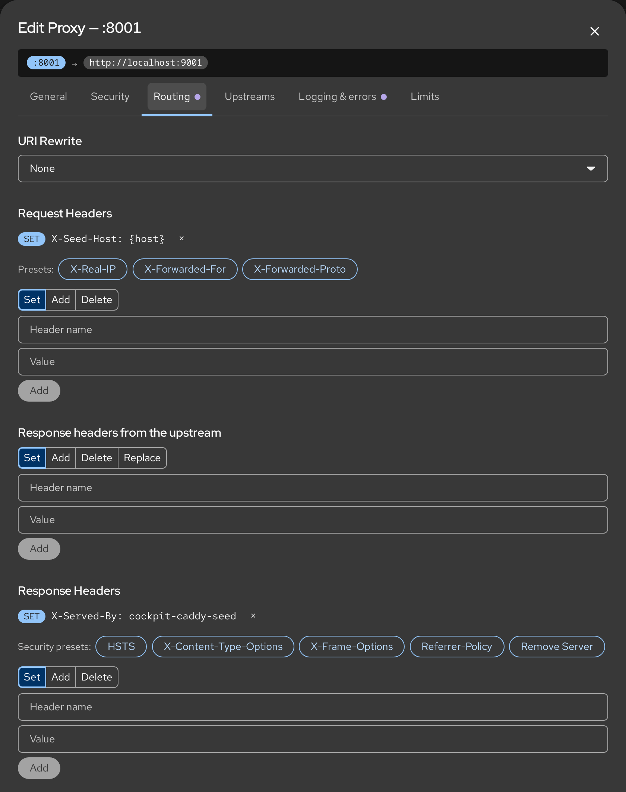
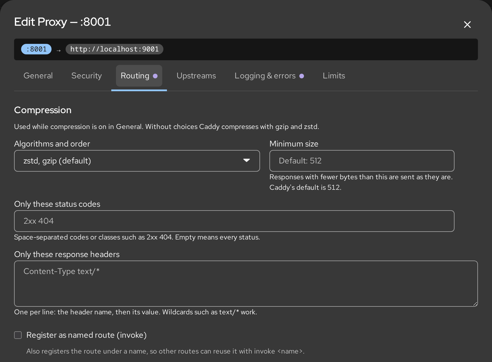

**Upstreams tab**:

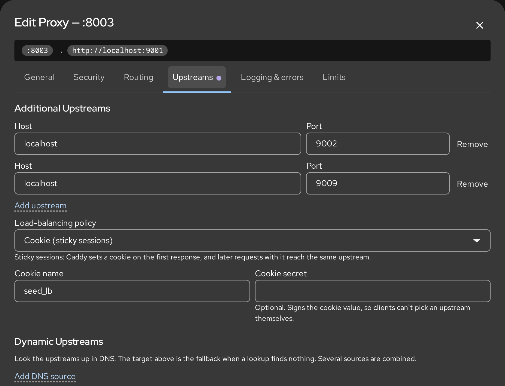
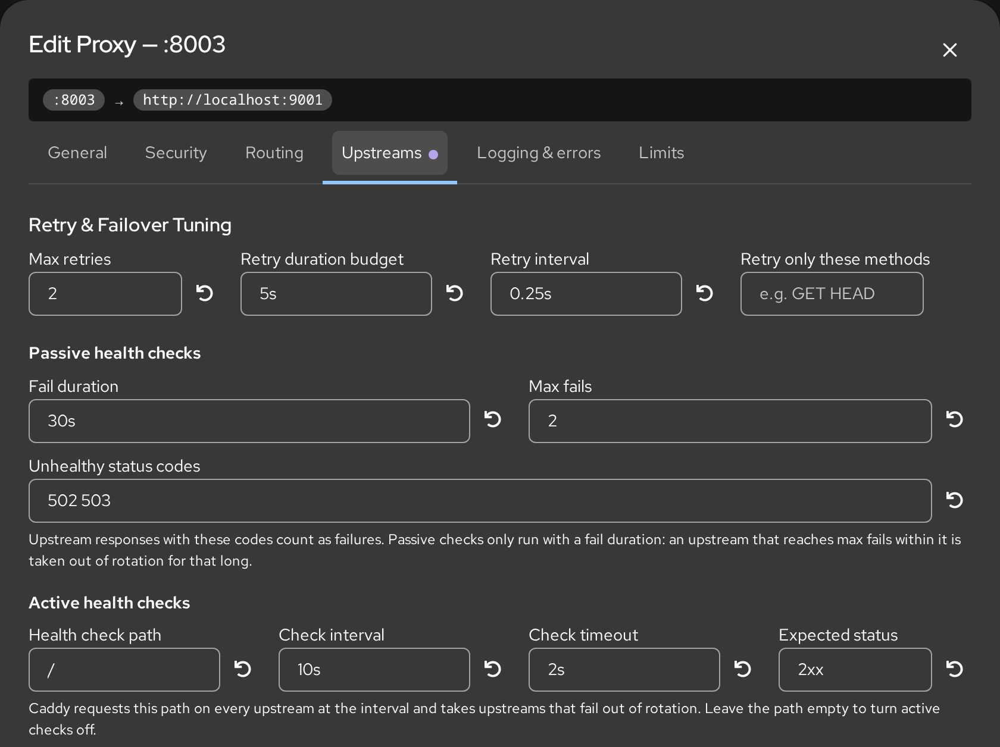
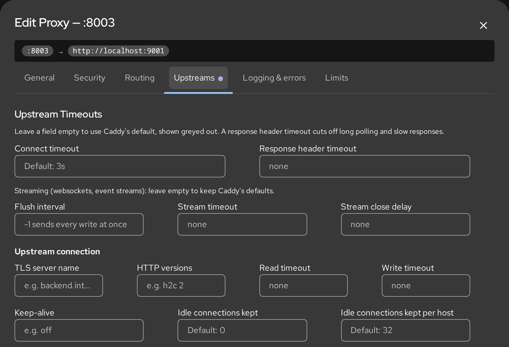

**Logging & errors tab**:

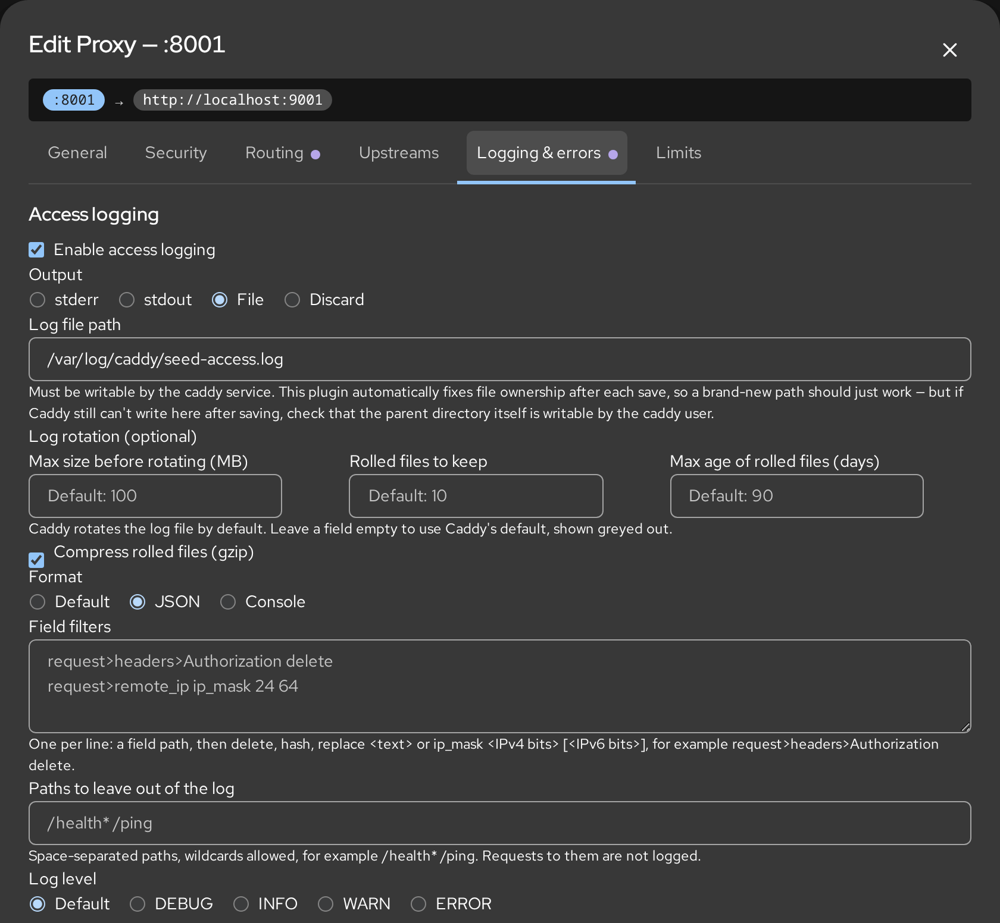
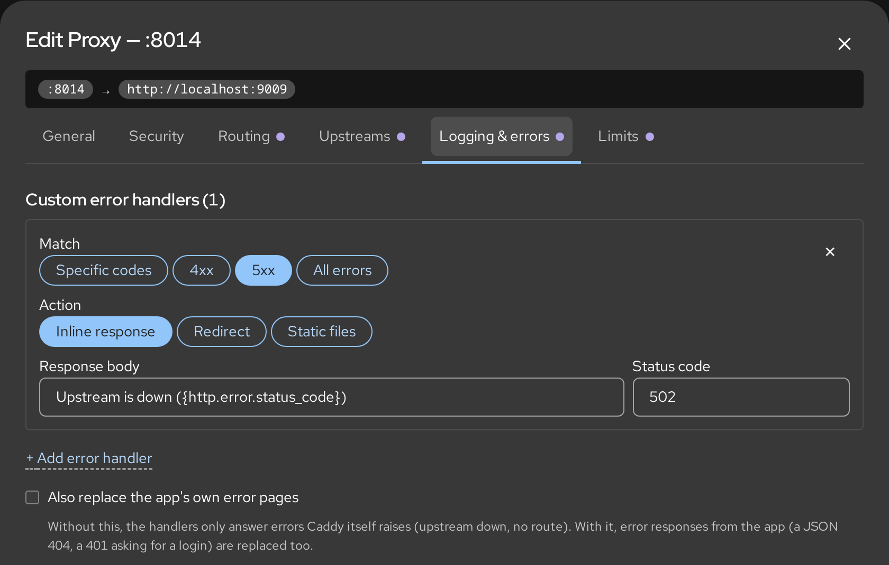

**Limits tab**:

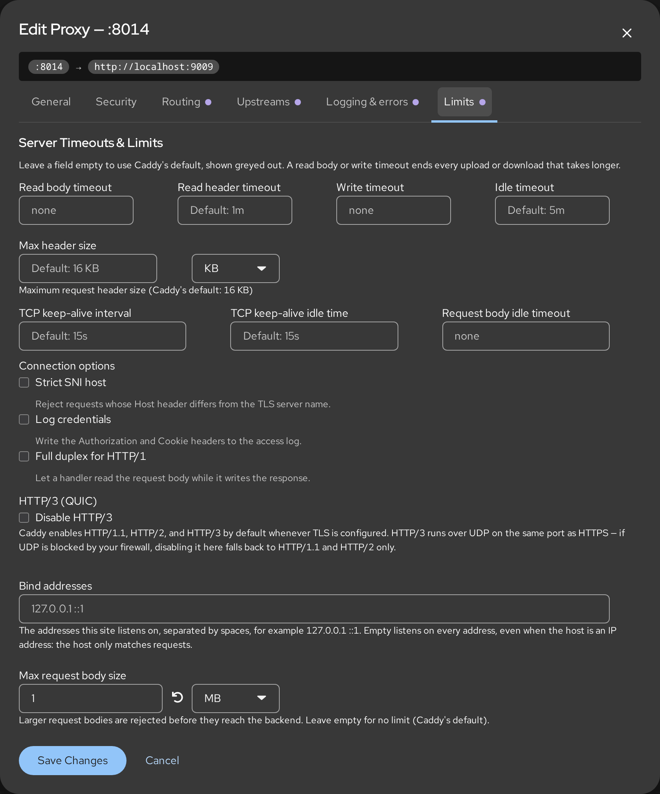

---

## Tree tab (nested route and handle blocks)

The form edits one handler per site. A site with a `route` block or with `handle` / `handle_path` blocks inside each other (written by hand or migrated) gets an extra **Tree** tab, and the list shows a badge on its row. The other tabs then only save the address, bind addresses, snippet imports and TLS; the blocks are left as written.

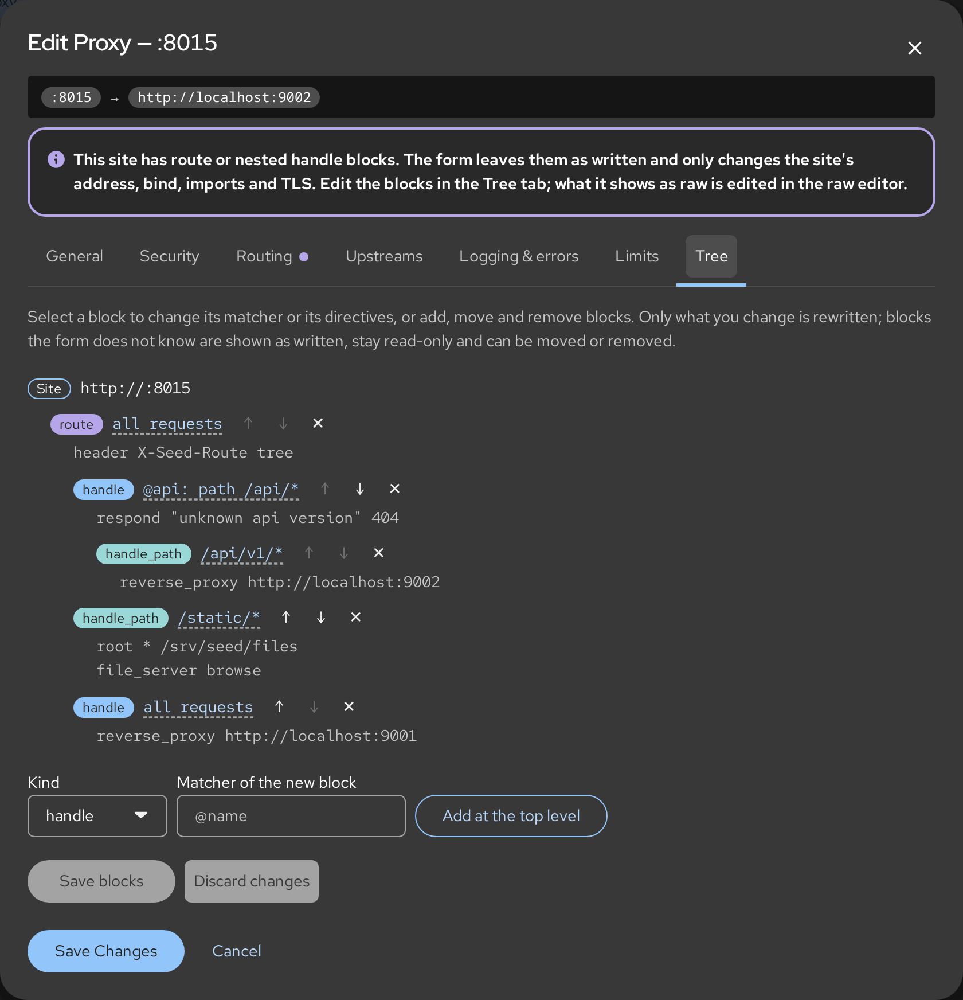

- Click a block's matcher to change it: a path (`/app/*`), an `@name`, or empty for every request. For a named matcher the matcher form opens, and a change rewrites the matcher's definition, so every block using it sees it. A `handle_path` needs one path.
- Directives the form knows can be edited in place; blocks it doesn't know are shown as written, stay read-only and can still be moved or removed.
- Add a block (kind + matcher) at the top level or inside the selected block. Move blocks with the arrows: inside a `route`, and among handles with named matchers, whose written order Caddy keeps. Caddy sorts the other blocks itself, by how specific their matchers are.
- Removing a block asks first and says how many blocks inside it go with it.
- **Save blocks** writes only what changed; **Discard changes** drops the edits. If the site was changed elsewhere since the tab read it, the save is refused: reopen the dialog.

---

## Static File Server

Choose **Add Proxy ▾ → Static files**.

### Required fields

| Field | Description |
|---|---|
| Port | External port Caddy listens on |
| Root Directory | Path on disk to serve files from (e.g. `/var/www/html`) |

### Optional fields

| Field | Description |
|---|---|
| Label | Human-readable name |
| Browse | Enable directory listing. While it is on, the advanced options add the listing's order (`sort`), the most entries it shows (`file_limit`), whether symlink targets are shown (`reveal_symlinks`), and a listing template |
| SPA mode | `try_files {path} /index.html`: existing files are served as they are, every other path gets `index.html`, so a single-page app's deep links work |
| File server options | Index file names, hidden files or patterns, precompressed formats (zstd, br, gzip) for `file.zst` / `file.br` / `file.gz` sidecar files, a status code for every file (e.g. `404` for a custom error page), **Run files through templates** (`templates`), and **Keep trailing slashes as they are** (`disable_canonical_uris`) |
| HTTPS certificate | Caddy's internal CA (default) or Off; a site with a public hostname can also use Automatic (Let's Encrypt / ACME) |
| Compression | Enable gzip/zstd compression |

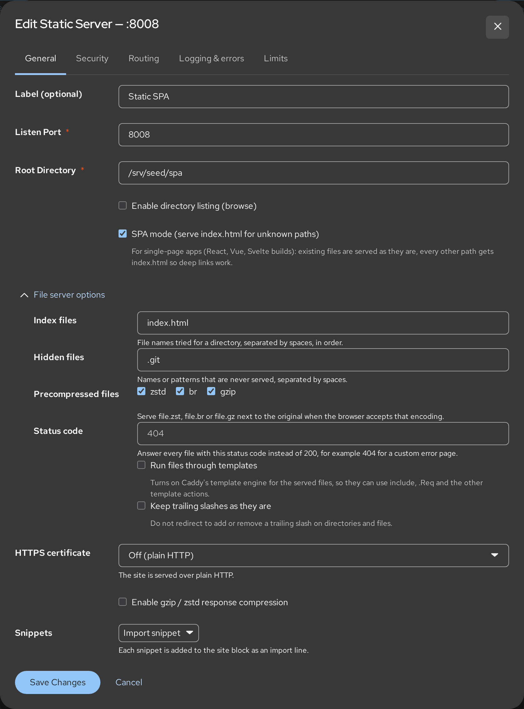

### Optional sections

Same as the proxy dialog except Transport, Rewrite, Forward Auth, Extra Upstreams, and Retry & Failover Tuning (which don't apply to a file server, since there's no upstream to dial): TLS Policy (including custom certificates), Access Log, Error Handlers, Server Timeouts, Basic Auth, Request Headers, Response Headers, and Route Matchers. The Max request body size field sits on the **Limits** tab.

---

## PHP Site

Choose **Add Proxy ▾ → PHP site**. Caddy passes `.php` requests to PHP-FPM with `php_fastcgi` and serves every other file (CSS, images, JS) itself with `file_server`.

| Field | Description |
|---|---|
| Port | External port Caddy listens on |
| FastCGI Upstream | The PHP-FPM socket (`unix//run/php-fpm/php-fpm.sock`) or TCP address (`127.0.0.1:9000`) |
| Root Directory | The app's document root |
| Index file | Optional; Caddy's default is `index.php` |
| Split path | Optional extensions that split the URI into script and path info; Caddy's default is `.php` |
| Environment variables | Extra variables passed to PHP |
| Try files | Optional candidates tried before PHP (`try_files`); a front-controller app (Laravel, Symfony, WordPress) usually needs `{path} {path}/ /index.php?{query}` |
| HTTPS certificate | As for a static site |

The other settings (Security, Routing, Logging & errors, Limits) are the same as for a static site.

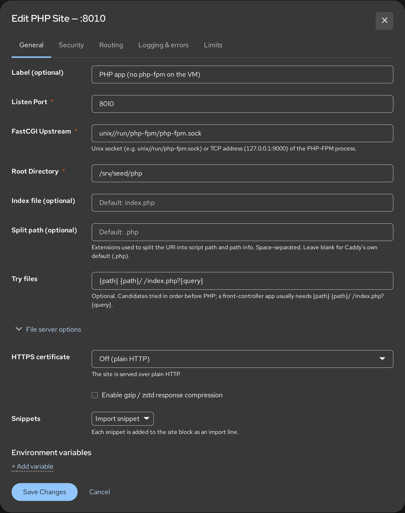

---

## Redirect

Choose **Add Proxy ▾ → Redirect**.

| Field | Description |
|---|---|
| Port | External port Caddy listens on |
| Redirect To | Target URL (e.g. `https://example.com`) |
| Status Code | HTTP redirect code (301, 302, 307, 308), or **HTML page**: a page that redirects in the browser, which keeps the URL's `#fragment` |
| Keep the path and query | Adds `{uri}` to the target, so `/a?b=1` goes to `/a?b=1` on the target |
| Label | Optional name |
| TLS | Caddy's internal CA (on by default) |

Route Matchers are also available for redirects inside a named server.

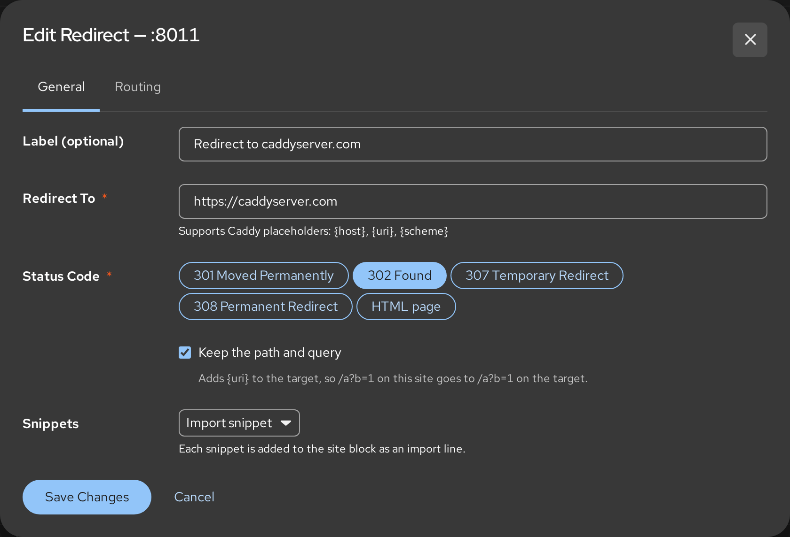

---

## Static Response

Choose **Add Proxy ▾ → Fixed response**. Returns a fixed HTTP response — useful for maintenance pages or health-check endpoints.

| Field | Description |
|---|---|
| Port | External port Caddy listens on |
| Status Code | HTTP status (100–599, default 200) |
| Response Body | Optional plain-text or HTML body |
| Close Connection | Close the connection after the response |
| Label | Optional name |
| TLS | Caddy's internal CA (on by default) |

Route Matchers are also available for respond entries inside a named server.

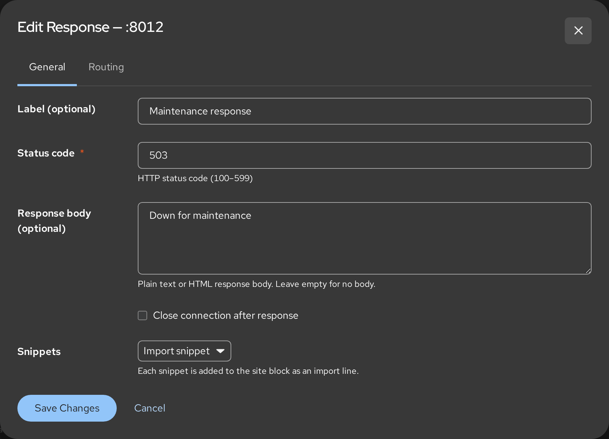

---

## Editing an entry

Click **Edit** on any row. The same dialog opens pre-filled with current values. All optional sections retain their existing configuration.

## Duplicating an entry

Click **Duplicate** on any row. The Add dialog opens pre-filled with all values from the source entry (port field left blank so it doesn't conflict). All optional sections are copied, except a per-site DNS challenge override, whose credentials belong to the original site. If the source route belongs to a named server, the duplicate is added to the same server.

## Deleting an entry

Click **Delete** on any row. A confirmation dialog appears before the entry is removed. Caddy reloads automatically after deletion.

---

## How entries map to the Caddyfile

**Standalone entry** — each entry is its own server block:

```caddyfile
:8443 {
    tls internal
    encode gzip zstd
    reverse_proxy localhost:8080
}
```

**Named server with multiple routes** — one block, routes use matchers:

```caddyfile
# server: public-https
# serverdef: {"name":"Public HTTPS","tls":true}
:443 {
    tls internal
    @r0 path /api/*
    handle @r0 {
        reverse_proxy localhost:3000
    }
    handle {
        reverse_proxy localhost:4000
    }
}
```

**Strip prefix (handle_path)**:

```caddyfile
handle_path /api/* {
    reverse_proxy localhost:3000
}
```

The plugin reads and writes these blocks surgically — editing one route never affects other routes in the same server. You can also edit the Caddyfile directly via the **Caddyfile** tab — the UI picks up any external changes after a Caddy reload.
